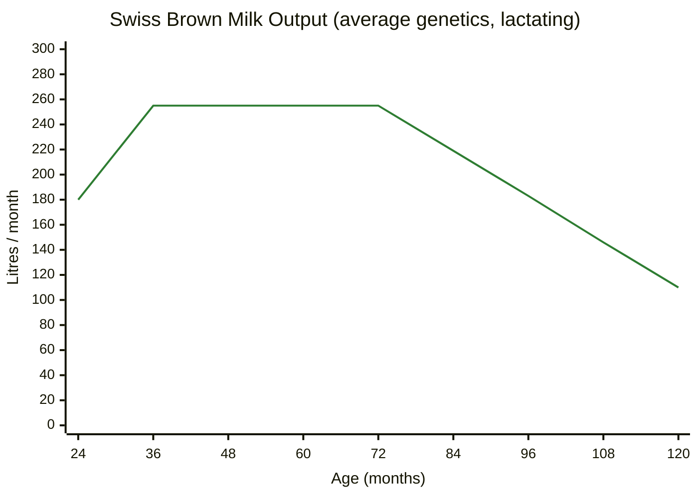

# Cattle Factsheet

Cattle are the most diverse livestock in Realistic Livestock RM, with 8 breeds ranging from high-output dairy cows to premium beef cattle. Each breed has distinct milk output, sell value, and feed requirements. Bulls are heavier and sell for more than cows at every age.

> **Note:** This documentation was generated with AI assistance and may contain inaccuracies. If you spot an error, please [open an issue](https://github.com/rittermod/FS25_RealisticLivestockRM/issues).

---

## Breeds at a Glance

| Breed | Type | Target Weight | Milk Range (peak, lactating) | Sell Value |
|-------|------|--------------|------------------------------|------------|
| **Holstein** | Dairy | 575 / 650 kg | 65 - 750 L/month | Moderate |
| **Hereford** | Dual | 675 / 750 kg | 55 - 600 L/month | Above average |
| **Swiss Brown** (Brown-Swiss in game) | Dual | 650 / 850 kg | 50 - 580 L/month | Above average |
| **Angus** | Beef | 700 / 900 kg | 30 - 365 L/month | High |
| **Highland** (Highland Cattle in game) *(DLC)* | Beef | 725 / 950 kg | 30 - 365 L/month | High, retains value in old age |
| **Brahman** *(DLC)* | Beef | 725 / 950 kg | 30 - 365 L/month | High, retains value in old age |
| **Limousin** | Beef | 630 / 675 kg | 30 - 320 L/month | Highest |
| **Water Buffalo** | Special | 425 / 500 kg | 5 - 70 L/month | Low |

*Target weights shown as cow / bull. Milk range shows the full span from poor to excellent genetics. All cows produce milk when lactating - beef breeds just produce less. Highland cattle require the Highlands Fishing Expansion, and Brahman cattle require the Beans & Alpacas Expansion.*

*Food, water, straw and production figures are per in-game month, whatever your month length. The animal's info box shows them per day, so with 3 days per month it shows a third of these figures.*

> **Breed-locking:** Water Buffalo bulls can only breed with Water Buffalo cows. All other bull breeds can breed with any non-Water-Buffalo cow.

> **Hereford on Witcombe:** When playing on the [Witcombe](map-witcombe.md) map, Hereford uses a heritage profile with 9-month gestation, premium sell prices, an earlier sell-price peak at 24 months (vs 36 months for other beef breeds), and lower water and straw needs. The values shown above are the standard RLRM Hereford used on every other map.

> **Hereford and Brahman on Le Mechet:** When playing on the [Le Mechet](map-le-mechet.md) map, Hereford and Brahman *(DLC)* are hidden from the Animal Dealer (the map ships no Hereford or Brahman 3D model). Le Mechet adds four French breeds in the dealer instead - Charolais, Montbeliarde, Simmental, and Vosgienne - see the map page for their breed character.

---

## Milk Production by Breed

Cows produce milk **only while lactating** (10 months after giving birth). Non-lactating cows produce zero milk.

### Milk Output Range (L/month, lactating cow)

| Breed | Under 36 mo | 36 mo (peak) | 120 mo |
|-------|-------------|--------------|-------|
| **Holstein** | 40 - 445 | **65 - 750** | 35 - 410 |
| **Hereford** | 40 - 435 | **55 - 600** | 25 - 285 |
| **Swiss Brown** | 35 - 410 | **50 - 580** | 20 - 250 |
| **Angus** | 20 - 230 | **30 - 365** | 15 - 160 |
| **Highland** | 20 - 230 | **30 - 365** | 15 - 160 |
| **Brahman** | 20 - 230 | **30 - 365** | 15 - 160 |
| **Limousin** | 20 - 205 | **30 - 320** | 10 - 115 |
| **Water Buffalo** | 5 - 70 | 5 - 70 | 5 - 70 |

*Genetics and lactation phase cause large variation between individual animals. Most cows produce somewhere in the middle of these ranges. A CVM carrier cow produces considerably more than a non-carrier with the same genetics while the **Diseases** setting is on.*

*Water Buffalo produce **buffalo milk** (a separate product from regular milk) with very low output that stays flat regardless of age.*

*Chart shows Swiss Brown as a representative mid-range breed with average genetics. Holstein produces more, beef breeds produce less - see the table above for per-breed ranges. The line is the **age** curve (the cow's lifetime production envelope while lactating); the **lactation-phase** curve within each 10-month nursing window is shown separately in the [Breeding Guide](guide-breeding.md#lactation-phase-curve), and the breed table's "50 - 580" range combines both factors with the genetics multiplier.*

---

## Sell Prices by Breed

Bulls consistently sell for more than cows at all ages. Beef breeds (Angus, Limousin, Highland, Brahman) command significantly higher prices than dairy breeds.

### Typical Sell Prices ($)

| Breed | | Newborn | 24 mo | 36 mo (peak) | 60 mo |
|-------|---|---------|-------|--------------|-------|
| **Swiss Brown** | Cow | 150 | 2,000 | 2,400 | 1,400 |
| | Bull | 220 | 2,400 | 2,800 | 1,800 |
| **Holstein** | Cow | 135 | 1,900 | 2,000 | 1,100 |
| | Bull | 200 | 2,250 | 2,600 | 1,500 |
| **Angus** | Cow | 200 | 2,800 | 3,800 | 2,000 |
| | Bull | 245 | 3,200 | 4,100 | 2,300 |
| **Limousin** | Cow | 225 | 2,950 | 4,000 | 2,200 |
| | Bull | 275 | 3,450 | 4,400 | 2,550 |
| **Hereford** | Cow | 210 | 2,200 | 2,800 | 1,600 |
| | Bull | 225 | 2,400 | 3,000 | 1,800 |
| **Highland** | Cow | 230 | 3,000 | 3,500 | 2,500 |
| | Bull | 280 | 3,500 | 4,000 | 3,000 |
| **Brahman** | Cow | 230 | 3,000 | 3,500 | 2,500 |
| | Bull | 280 | 3,500 | 4,000 | 3,000 |
| **Water Buffalo** | Cow | 150 | 1,500 | 1,500 | 1,000 |
| | Bull | 200 | 1,750 | 2,000 | 1,250 |

*These are typical prices for an average, healthy animal. Actual prices vary widely - well-bred healthy animals sell for significantly more, poor-quality animals can sell for far less, and a sick animal cannot be sold at the dealer until it recovers.*

### What Affects Sell Price

| Factor | Effect |
|--------|--------|
| Quality genetics | Better genetics -> considerably higher price |
| Weight | Well-fed animals near target weight are worth more |
| Health | Healthy animals sell for significantly more |
| Lactating | Small price bonus |
| Pregnant | Moderate price bonus |
| Castrated | Small price bonus |
| Diseases | A sick animal cannot be sold at the dealer until it recovers |

### Buy Prices

The dealer's price is the animal's own sale value plus a markup that depends on the [**Dealer Animal Quality**](reference-settings.md#dealer-ai) setting, plus a transport fee per animal. So it follows the same things as the sale value: age, genetics, health, weight and pregnancy. Buying into a trailer at the dealer has no transport fee.

The transport fee grows with age, from $40 for a newborn to $200 for a cow or $500 for a bull at 18 months and older. It also comes off the price when you sell.

---

## Food & Water Consumption by Breed

Genetics significantly affect how much each animal eats - some are naturally much more efficient than others. Lactating cows eat noticeably more, and the Food Scale setting also adjusts consumption. Food and water rise through a pregnancy: noticeably higher by the end with one calf, considerably with twins.

### Food Consumption Range (L/month)

| Breed | | Newborn | 18+ mo (adult) |
|-------|---|---------|-----------------|
| **Swiss Brown** | Cow | 25 - 175 | 85 - 600 |
| | Bull | 25 - 175 | 90 - 620 |
| **Holstein** | Cow | 23 - 158 | 83 - 578 |
| | Bull | 23 - 158 | 85 - 595 |
| **Angus** | Cow | 20 - 140 | 110 - 770 |
| | Bull | 20 - 140 | 115 - 790 |
| **Limousin** | Cow | 20 - 150 | 120 - 840 |
| | Bull | 20 - 150 | 125 - 860 |
| **Hereford** | Cow | 16 - 114 | 95 - 665 |
| | Bull | 18 - 123 | 105 - 735 |
| **Highland** | Cow | 20 - 140 | 140 - 960 |
| | Bull | 20 - 140 | 145 - 1,005 |
| **Brahman** | Cow | 20 - 140 | 140 - 960 |
| | Bull | 20 - 140 | 145 - 1,005 |
| **Water Buffalo** | Cow | 10 - 70 | 90 - 615 |
| | Bull | 10 - 80 | 95 - 655 |

*Highland, Brahman and Limousin are the most expensive breeds to feed. Ranges show the span from the most efficient to the hungriest animals. Most animals eat near the middle of these ranges.*

### Water Consumption (L/month, newborn -> adult)

| Breed | Cow | Bull |
|-------|-----|------|
| **Swiss Brown** | 55 -> 130 | 55 -> 130 |
| **Holstein** | 45 -> 120 | 45 -> 120 |
| **Angus** | 65 -> 180 | 65 -> 180 |
| **Limousin** | 70 -> 200 | 70 -> 200 |
| **Hereford** | 60 -> 150 | 65 -> 160 |
| **Highland** | 20 -> 140 | 20 -> 140 |
| **Brahman** | 20 -> 140 | 20 -> 140 |
| **Water Buffalo** | 20 -> 140 | 20 -> 140 |

*Lactating cows drink considerably more water than usual, and water rises through a pregnancy just as food does.*

### Straw Consumption (L/month, newborn -> adult)

| Breed | Cow | Bull |
|-------|-----|------|
| **Swiss Brown** | 10 -> 95 | 10 -> 95 |
| **Holstein** | 10 -> 95 | 10 -> 95 |
| **Angus** | 15 -> 130 | 15 -> 130 |
| **Limousin** | 15 -> 130 | 15 -> 130 |
| **Hereford** | 15 -> 130 | 15 -> 130 |
| **Highland** | 15 -> 130 | 15 -> 130 |
| **Brahman** | 15 -> 130 | 15 -> 130 |
| **Water Buffalo** | 10 -> 95 | 10 -> 95 |

*Straw is not affected by genetics or lactation. Beef breeds use more straw than dairy breeds.*

---

## Weights by Breed

| Breed | | Birth | Target | Maximum |
|-------|---|-------|--------|---------|
| **Swiss Brown** | Cow | 40 kg | 650 kg | 1,200 kg |
| | Bull | 40 kg | 850 kg | 1,400 kg |
| **Holstein** | Cow | 42 kg | 575 kg | 1,200 kg |
| | Bull | 45 kg | 650 kg | 1,400 kg |
| **Angus** | Cow | 32 kg | 700 kg | 1,200 kg |
| | Bull | 35 kg | 900 kg | 1,400 kg |
| **Limousin** | Cow | 36 kg | 630 kg | 1,200 kg |
| | Bull | 39 kg | 675 kg | 1,400 kg |
| **Hereford** | Cow | 33 kg | 675 kg | 1,200 kg |
| | Bull | 35 kg | 750 kg | 1,400 kg |
| **Highland** | Cow | 35 kg | 725 kg | 1,200 kg |
| | Bull | 35 kg | 950 kg | 1,600 kg |
| **Brahman** | Cow | 35 kg | 725 kg | 1,200 kg |
| | Bull | 35 kg | 950 kg | 1,600 kg |
| **Water Buffalo** | Cow | 35 kg | 425 kg | 1,200 kg |
| | Bull | 36 kg | 500 kg | 1,400 kg |

*Higher metabolism animals reach target weight faster but eat more. Metabolism also moves each animal's own target weight: high-metabolism animals settle noticeably above the figure shown, low-metabolism animals noticeably below it. Castrated animals grow faster than intact males.*

---

## Reproduction

All cattle breeds share the same reproduction rules:

| Parameter | Value |
|-----------|-------|
| Cow breeding age | 12+ months |
| Bull breeding age | 12+ months |
| Bull retires at | 132 months (11 years) |
| Cow fertility ends | 132 months (11 years) |
| Gestation | 10 months |
| Lactation duration | 10 months after birth |

*See the [Breeding Reference](reference-breeding.md) for a side-by-side table of breeding ages, gestation, and litter sizes across all species.*

### Offspring per Birth

Cattle almost always produce a single calf. Litter size is mostly chance. Well below average fertility rules out the largest litters; above average adds nothing.

| Outcome | Likelihood |
|---------|------------|
| 1 calf | Most likely |
| Twins | Uncommon |
| Triplets | Rare |

*Age does not change a cow's chance of conceiving - fertility genetics do. That chance holds until her end age of 132 months, then stops outright. Litter size does not depend on age either. A cow must be at 75% health or above to conceive.*

### Breeding Restrictions

- Water Buffalo bulls can **only** breed Water Buffalo cows
- All other bull breeds can cross-breed with any cow breed except Water Buffalo
- A bull will not breed with a cow that's already pregnant
- A bull will not breed with his own daughters

---

## Lifespan & Death

| Event | Age |
|-------|-----|
| Fertility ends | 132 months (11 years) |
| Old age deaths begin | 180 months (15 years) |
| Maximum lifespan (rarely reached) | ~240 months (20 years) |

*Most animals die of old age well before this; only the best health genetics get close. Death can be toggled off in settings. Accidents can happen at any age (affected by weather). Animals in poor health can also die at any age, the very young most easily.*

---

## Diseases

| Disease | Spread | Fatal? | Treatment | Impact on Cows |
|---------|--------|--------|-----------|----------------|
| **Mastitis** | Slowly | Rarely | 1 month, $200 | Stops all milk production |
| **CVM** | Genetic only | Affected animals almost always, within a few months | None | Carrier cows produce considerably more milk while **Diseases** is on |
| **Foot and Mouth** | Rapidly | Low to moderate | 1 month, $250 | Severe milk reduction, major price loss |
| **BRD** | Moderately | Moderate - worst in calves | 1 month, $300 | Noticeably less milk, moderate price loss |
| **Footrot** | Slowly | Never | 1 month, $100 (cures about 9 times in 10) | Noticeably less milk for at least 6 months untreated, major price loss |

*Mastitis only affects lactating cows. The Fatal column holds while **Animal Death** is on. A sick animal cannot be sold at the dealer; the price loss shown is its value while sick, which sets what culling pays. See the [Disease Guide](guide-diseases.md) for detailed prevention and treatment.*

Cattle can be vaccinated against BRD and footrot, and cows against mastitis - see [Vaccination](guide-diseases.md#vaccination).

---

## Tips

1. **Dairy farming:** Holstein cows produce the most milk by far. Keep them breeding regularly - non-lactating cows produce zero milk.

2. **Beef farming:** Limousin and Angus sell for the highest prices. Highland and Brahman cattle *(DLC)* retain good value even in old age, making them lower-maintenance for long-term herds.

3. **CVM carriers:** CVM carrier cows give considerably more milk while the **Diseases** setting is on. Breed them with non-carriers: two carriers bred together give no more carrier calves than a carrier and a non-carrier, only about a quarter affected calves on top, which are sick and, with **Animal Death** on, die within a few months.

4. **Water Buffalo** are a niche choice with very low milk output. They require their own breed-specific bull. Not recommended for dairy income.

5. **Bulls sell for more** than cows at every age. If you're selling calves, bulls are more profitable. Castrated animals also get a small price bonus.
