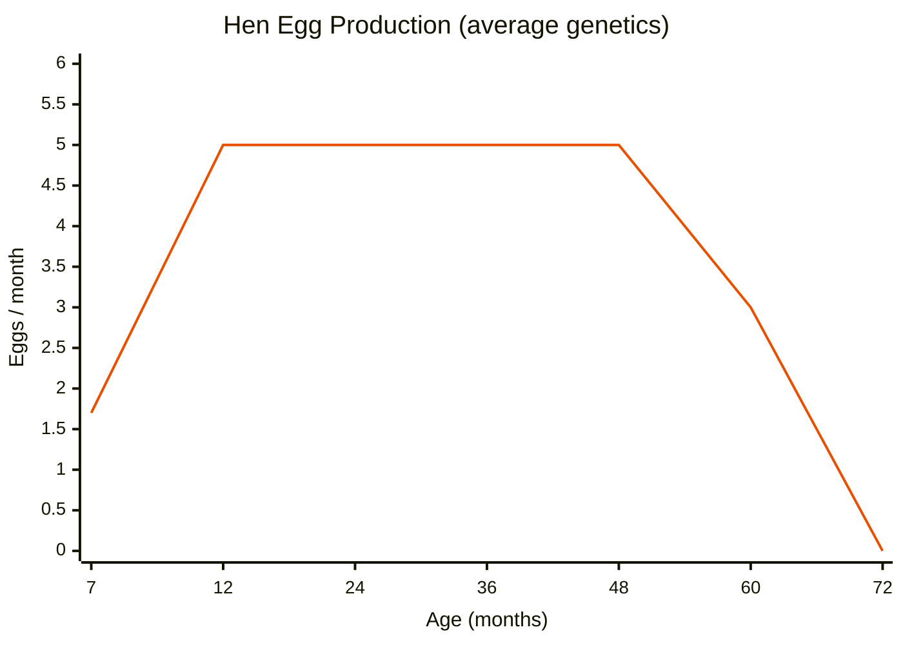

# Chickens Factsheet

Chickens are the cheapest and shortest-lived animals in Realistic Livestock RM. Hens produce eggs without needing a rooster, but hatching chicks requires one. There's only one breed - the key difference is between hens (egg layers) and roosters (breeding enablers, no eggs).

> **Note:** This documentation was generated with AI assistance and may contain inaccuracies. If you spot an error, please [open an issue](https://github.com/rittermod/FS25_RealisticLivestockRM/issues).

---

## At a Glance

| Stat | Hen | Rooster |
|------|-----|---------|
| **Target Weight** | 3.25 kg | 4.25 kg |
| **Egg Range (peak)** | **1 - 9 eggs/month** | - |
| **Sell Price (adult)** | $1 - $45 | $1 - $45 |

*Roosters are heavier but eat noticeably less food than hens at adult age. Sell prices vary with genetics and health but chickens are always low-value - their worth is in egg production.*

*Food, straw and production figures are per in-game month, whatever your month length. The animal's info box shows them per day, so with 3 days per month it shows a third of these figures.*

---

## Egg Production (Hens Only)

Hens lay eggs regardless of whether a rooster is present - a rooster is only needed for hatching chicks. Egg production follows an age-based curve.

### Egg Output Range (eggs/month)

| Age | Range |
|-----|-------|
| 0-6 mo | 0 |
| 7 mo | 0 - 3 |
| 12-48 mo (peak) | **1 - 9** |
| 60 mo | 1 - 5 |
| 72+ mo | 0 |

*Egg production peaks at 12 months and holds steady until 48 months, then declines to zero by 72 months (6 years). Genetics cause large variation between individual hens. With Avian Flu (LPAI), egg production is severely reduced while a bird is sick.*

*Chart shows average genetics - individual hens will vary above and below this line.*

---

## Sell & Buy Prices

Chicken prices are low and identical for hens and roosters:

| Age | Sell Price |
|-----|------------|
| Newborn | $2 |
| Adult (6+ mo) | $25 |

*Actual sell prices vary - well-bred healthy chickens sell for more, and a sick bird cannot be sold at the dealer until it recovers. Even at peak value chickens are worth very little. Their value is in egg production.*

### What Affects Sell Price

| Factor | Effect |
|--------|--------|
| Quality genetics | Better genetics -> considerably higher price |
| Weight | Well-fed birds near target weight are worth more |
| Health | Healthy birds sell for more |
| Pregnant | Moderate price bonus |
| Avian Flu (LPAI or HPAI) | A sick bird cannot be sold at the dealer until it recovers |

### Buy Prices

The dealer's price is the bird's own sale value plus a markup that depends on the [**Dealer Animal Quality**](reference-settings.md#dealer-ai) setting, plus a transport fee per bird. So it follows the same things as the sale value: age, genetics, health, weight and pregnancy. Buying into a trailer at the dealer has no transport fee.

---

## Food & Straw

### Food Consumption Range (L/month)

| Age | Hen | Rooster |
|-----|-----|---------|
| Newborn | 0 - 2 | 0 - 2 |
| 6 mo | 1 - 5 | 1 - 5 |
| 12+ mo (adult) | **2 - 12** | **1 - 9** |

*Roosters eat noticeably less than hens at adult age. Ranges show the span from the most efficient to the hungriest birds. Food rises through a pregnancy, more with a bigger clutch, up to about double.*

### Straw Consumption (L/month)

| Age | Straw (both) |
|-----|-------------|
| Newborn | 1 |
| 6 mo | 3 |
| 12+ mo | 7 |

*Chickens have no water input. Straw is not affected by genetics.*

---

## Weights

| Stat | Hen | Rooster |
|------|-----|---------|
| **Birth** | about 0.5 kg | about 0.5 kg |
| **Target** | 3.25 kg | 4.25 kg |
| **Maximum** | 4.5 kg | 5.5 kg |

---

## Reproduction

| Parameter | Value |
|-----------|-------|
| Hen breeding age | 6+ months |
| Rooster breeding age | 6+ months |
| Rooster max breeding age | 72 months (6 years) |
| Hen fertility ends | 60 months (5 years) |
| Gestation (hatching) | 2 months |
| Min health to breed | 75% |

*See the [Breeding Reference](reference-breeding.md) for a side-by-side table of breeding ages, gestation, and litter sizes across all species.*

> **Eggs vs chicks:** Hens lay eggs as an output product automatically (no rooster needed). But to **hatch chicks** (reproduction), a rooster must be in the same pen.

### Chicks per Hatch

A successful hatch is typically around 5 chicks. Hatch size is mostly chance. Well below average fertility rules out the largest hatches; above average adds nothing.

| Outcome | Likelihood |
|---------|------------|
| ~5 chicks (typical) | Most likely |
| 6 chicks | Uncommon |
| Fewer chicks | Uncommon |
| 7 chicks | Rare |
| 8 or more chicks | Very rare |

*Hatch size does not depend on age. Age does not change a hen's chance of conceiving - fertility genetics do. That chance holds until her end age of 60 months (5 years), then stops outright - after that she still lays eggs but hatches no chicks. Only animals with poor fertility genetics slow down in their last stretch. A hen must be at 75% health or above to hatch a clutch.*

---

## Lifespan & Death

| Event | Age |
|-------|-----|
| Hen stops breeding | 60 months (5 years) |
| Rooster stops breeding | 72 months (6 years) |
| Egg production ends | ~72 months (6 years) |
| Old age deaths begin | 60 months (5 years) |
| Maximum lifespan (rarely reached) | ~96 months (8 years) |

*Most animals die of old age well before the maximum lifespan; only the best health genetics get close. Chickens have the shortest lifespan. Old age deaths can begin while hens are still laying eggs. Hens stop hatching chicks entirely at 60 months - the same age old-age deaths begin. Death can be toggled off in settings.*

---

## Diseases

| Disease | Spread | Fatal? | Treatment | Impact |
|---------|--------|--------|-----------|--------|
| **Avian Flu (LPAI)** | Moderately | Low | 1 month, $5 | Egg production severely reduced while a bird is sick |
| **Avian Flu (HPAI)** | Rapidly | Almost always fatal | **None** - cull | Rare; eggs unchanged |

*The Fatal column holds while **Animal Death** is on. A sick bird cannot be sold at the dealer, and culling one pays nothing.*

> **Two strains of avian flu.** LPAI is the common one: cheap to treat and rarely fatal, but egg production is severely reduced while a bird is sick. HPAI is rare but, with **Animal Death** on, almost always fatal, and it has no treatment - cull a sick bird from the Diseases dialog on the day it shows, because a bird culled that day infects nobody. Survivors are immune for 12 months (LPAI) or 24 months (HPAI). See the [Disease Guide](guide-diseases.md).

---

## Tips

1. **Hens don't need roosters for eggs.** You only need a rooster if you want to hatch chicks. A pen full of hens produces maximum eggs with zero breeding overhead.

2. **Peak production is 12-48 months.** Buy young hens and plan to replace them before they hit 48 months (4 years) when production starts declining.

3. **Watch for HPAI.** It has no treatment and sick birds cannot be sold at the dealer - cull each case from the Diseases dialog on the day it shows. LPAI, the common strain, is cheap to treat.

4. **Cheap but productive.** At a few dollars per chick and up to 9 eggs a month at peak, chickens have the best return-on-investment for small farms. The initial cost is negligible.

5. **Short lifespan warning.** Chickens can start dying of old age at just 5 years - while they're still laying. Sell older hens before they die to recover whatever small value they have.
