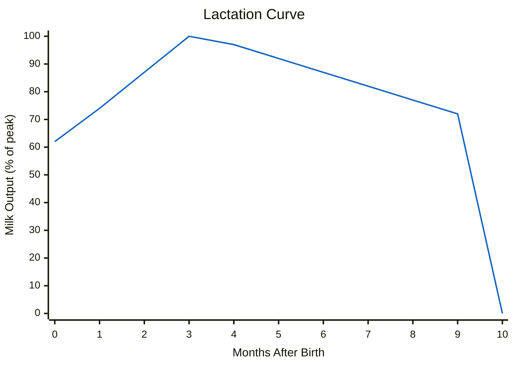

# Breeding Guide

Realistic Livestock RM replaces the base game's automatic reproduction with a realistic system requiring males and females, age requirements, health thresholds, and species-specific gestation periods. This guide covers everything you need to know about breeding.

> **Note:** This documentation was generated with AI assistance and may contain inaccuracies. If you spot an error, please [open an issue](https://github.com/rittermod/FS25_RealisticLivestockRM/issues).

---

## Requirements for Breeding

For reproduction to occur, ALL of the following must be true:

1. **Male and female** of the same species in the same pen (or artificial insemination)
2. Female has reached **minimum breeding age**
3. Male has not exceeded **maximum breeding age**
4. Female is **not already pregnant**
5. Female health is **75% or above**
6. Female is not the **daughter of that specific male** (inbreeding prevention)
7. Mother has **recovered from her last birth**: a mother cannot conceive again for 3 months after giving birth. Lactation does not block conception.

---

## Breeding Ages & Gestation

| Species | Female Breeds From | Male Breeds From | Male Breeds Until | Gestation | Female Fertility Ends |
|---------|-------------------|-----------------|-------------------|-----------|----------------------|
| **Cattle** | 12 months | 12 months | 132 months (11 yr) | 10 months | 132 months (11 yr) |
| **Pigs** | 6 months | 8 months | **48 months (4 yr)** | 4 months | 96 months (8 yr) |
| **Sheep** | 8 months | 5 months | **72 months (6 yr)** | 5 months | 120 months (10 yr) |
| **Goats** | 8 months | 5 months | 72 months (6 yr) | 5 months | 120 months (10 yr) |
| **Horses** | 22 months | 24 months | 300 months (25 yr) | 11 months | 264 months (22 yr) |
| **Chickens** | 6 months | 6 months | 72 months (6 yr) | 2 months | 60 months (5 yr) |
| **Alpacas** *(Beans & Alpacas Expansion)* | 14 months | 24 months | 120 months (10 yr) | 11 months | 180 months (15 yr) |

*A female can conceive from the month after the age shown.*

*See the [Breeding Reference](reference-breeding.md) for a per-breed view that splits female and male rows and includes peak litter sizes.*

> **Critical insight:** Males retire from breeding much earlier than females in some species! Boars stop at 4 years while sows breed until 8. Rams stop at 6 years while ewes breed until 10. Plan male replacements early.

> **Genetics matter:** These ages are when a male normally stops breeding. With a younger male in the pen, a high-fertility older male can still father young past his age. A male with poor fertility genetics stops fathering earlier: the female can still conceive while he is in the pen, but the young get no recorded father, average sire genetics and their mother's breed. Roosters are the exception: their 72-month limit is the same for every rooster, whatever his genetics.

---

## Breed Restrictions

Most males can breed with any female of their species, with two important exceptions:

| Male | Can Breed With |
|------|---------------|
| **Water Buffalo Bull** | Water Buffalo cows **only** |
| **Ram Goat** | Goats **only** |
| Any other Bull | Any cow breed (except Water Buffalo) |
| Any other Ram | Any sheep breed (except Goats) |
| All Boars | Any pig breed |
| All Stallions | Any horse colour |
| All Roosters | Any hen |
| All Alpaca males *(Beans & Alpacas Expansion)* | Any alpaca colour |

*Cross-breeding between different breeds of the same species is allowed (e.g., Angus bull × Holstein cow), except for breed-locked types. See [Offspring Breed](#offspring-breed) below for what breed the offspring will be.*

---

## Offspring Breed

When two different breeds produce offspring, each baby independently has a **50/50 chance** of inheriting either parent's breed. There is no visual blending -- the offspring will look exactly like one parent's breed or the other.

| Breeding Pair | Possible Offspring |
|---------------|-------------------|
| Angus bull × Holstein cow | Each calf: 50% Angus, 50% Holstein |
| Highland bull × Hereford cow | Each calf: 50% Highland, 50% Hereford |
| Landrace boar × Berkshire sow | Each piglet: 50% Landrace, 50% Berkshire |
| Landrace ram × Steinschaf ewe | Each lamb: 50% Landrace, 50% Steinschaf |

*Same-breed parents always produce same-breed offspring.*

### Litters and Twins

Each offspring rolls its breed independently. A Berkshire sow bred by a Landrace boar could produce a mixed litter -- some piglets are Landrace, others are Berkshire. The same applies to sheep twins or cattle twins: each baby gets its own 50/50 roll.

**Example:** A Berkshire sow produces a litter of 12 piglets sired by a Landrace boar. On average, about 6 will be Berkshire and 6 will be Landrace -- but any specific litter might skew 8/4 or even 10/2 by chance, just like flipping a coin 12 times won't always give exactly 6 heads.

### Artificial Insemination

When using artificial insemination, offspring **always inherit the mother's breed**. A straw shows its sire's breed, but only his genetics are passed on, so all offspring will be the same breed as their mother.

If breed consistency matters to you, AI is a reliable way to ensure it.

### Breed vs Genetics

Don't confuse breed inheritance with genetic trait inheritance -- they work differently:

| Aspect | How It Works |
|--------|-------------|
| **Breed** (appearance) | 50/50 coin flip -- one parent's breed or the other, no blending |
| **Genetics** (traits) | Always blended from both parents, regardless of breed outcome |

A Holstein calf from an Angus bull × Holstein cow cross inherits its Holstein appearance, but its productivity, health, fertility, and other genetic traits are still a blend of both the Angus father and the Holstein mother. The same applies in reverse for an Angus calf from the same pairing.

*In other words: cross-breeding doesn't affect genetic inheritance. Your offspring's traits are always influenced by both parents -- only the visual breed is one-or-the-other.*

### Practical Tips

1. **Want breed-pure offspring?** Use same-breed parents, or use artificial insemination.
2. **Cross-breeding for genetics?** If the best bull in your pen is a different breed, the offspring will still inherit his genetic traits -- they'll just look like one breed or the other.
3. **Selling cross-bred litters?** Breed affects sell price (e.g., Berkshire pigs sell for more than Black Pied). In a mixed litter, each piglet's value depends on which breed it inherited.

---

## Offspring per Birth

Two things decide how many young you get: whether the mother conceives at all, and how large the litter is once she does.

- **Chance of conceiving.** Age does not change her chance of conceiving - **fertility genetics** do. That chance holds until her end age (see the table above), then stops outright.
- **Litter size** does *not* depend on age. Each birth is usually the species' typical size, and litter size is mostly chance. How much fertility genetics matter is listed per species below.

### Cattle

Cattle almost always produce a single calf. Twins and triplets can happen. Litter size is mostly chance. Well below average fertility rules out the largest litters; above average adds nothing.

| Outcome | Likelihood |
|---------|------------|
| 1 calf | Most likely |
| Twins | Uncommon |
| Triplets | Rare |

*Age does not change a cow's chance of conceiving - fertility genetics do. That chance holds until 132 months (11 years), then stops outright.*

### Pigs

Pigs produce the largest litters -- typically around 12 piglets, with 16 the most a sow can have. Litter size is mostly chance. Well below average fertility rules out the largest litters; above average adds nothing.

| Outcome | Likelihood |
|---------|------------|
| ~12 piglets (typical) | Most likely |
| Smaller litter | Uncommon |
| 13-15 piglets | Rare |
| 16 piglets | Very rare |

*Age does not change a sow's chance of conceiving - fertility genetics do. That chance holds until 96 months (8 years), then stops outright.*

### Sheep & Goats

Sheep and goats usually produce twins. Singles and triplets both occur. Litter size is mostly chance. Low fertility makes triplets a little less likely; above average adds nothing.

| Outcome | Likelihood |
|---------|------------|
| Twins | Most likely |
| Triplets | Uncommon |
| Single | Uncommon |

*Twins are the most common outcome at every age, including first-time mothers. Goats breed from the same age as sheep (8 months). Age does not change a mother's chance of conceiving - fertility genetics do. That chance holds until 120 months (10 years), then stops outright. Only animals with poor fertility genetics slow down in their last stretch.*

### Horses

Horses almost always produce a single foal. Twins are uncommon and triplets are rare. Litter size is mostly chance. Well below average fertility rules out the largest litters; above average adds nothing.

| Outcome | Likelihood |
|---------|------------|
| 1 foal | Most likely |
| Twins | Uncommon |
| Triplets | Rare |

*Age does not change a mare's chance of conceiving - fertility genetics do. That chance holds until 264 months (22 years), then stops outright. Only animals with poor fertility genetics slow down in their last stretch.*

### Chickens

A successful hatch is typically around 5 chicks. Bigger hatches are rare, and 8 or more is very rare. Litter size is mostly chance. Well below average fertility rules out the largest litters; above average adds nothing.

| Outcome | Likelihood |
|---------|------------|
| ~5 chicks (typical) | Most likely |
| 6 chicks | Uncommon |
| Fewer chicks | Uncommon |
| 7 chicks | Rare |
| 8 or more chicks | Very rare |

*Age does not change a hen's chance of hatching a clutch - fertility genetics do. That chance holds until 60 months (5 years), then stops outright -- after that she still lays eggs but hatches no chicks. Only animals with poor fertility genetics slow down in their last stretch.*

### Alpacas

*Beans & Alpacas Expansion.* Mostly one young, and twins are down to chance. Alpacas have no lactation period. See the [Alpacas Factsheet](factsheet-alpacas.md).

| Outcome | Likelihood |
|---------|------------|
| 1 young | Most likely |
| Twins | Uncommon |

*Age does not change a female's chance of conceiving - fertility genetics do. That chance holds until 180 months (15 years), then stops outright. Only animals with poor fertility genetics slow down in their last stretch.*

---

## Lactation

Cows and goats enter a lactation period after giving birth. This has major effects on both production and consumption.

| Parameter | Value |
|-----------|-------|
| Duration | 10 months after birth |
| Milk production | Only during lactation (zero otherwise) |
| Food consumption | Noticeably higher during lactation |
| Water consumption | Considerably higher during lactation |
| Sell price | Small bonus while lactating |

### Lactation Phase Curve

Milk output varies within the lactation period:

| Months Since Birth | Milk Output |
|-------------------|-------------|
| 0-2 | Ramping up (below full potential) |
| 3 | **Peak production** |
| 4-9 | Gradually declining |
| 10+ | Lactation ends (zero milk) |

*Peak milk production occurs at month 3 after birth. See the cattle and sheep factsheets for specific breed output ranges.*

*Chart shows the lactation factor as a percentage of peak output (month 3). Production starts at ~62% of peak at birth and declines gradually, dropping to zero at month 10. Actual litres depend on breed and genetics - see the cattle factsheet for specific ranges.*

---

## Feeding During Pregnancy

Food and water rise through a pregnancy, more with a bigger litter.

| Species | Food and water |
|---------|----------------|
| Cattle, Horses | Noticeably higher by the end, considerably with twins |
| Sheep, Goats | Considerably higher by the end |
| Alpacas | Noticeably higher by the end |
| Pigs | A pregnant sow eats and drinks up to about twice as much as usual for most of her pregnancy |
| Chickens | Food only, as chickens take no water: up to about double by the end |

---

## Pregnancy Complications

Breeding requires the mother to be at 75% health or above to conceive (see [Requirements](#requirements-for-breeding)). Once she is pregnant, birth is usually safe, but with the **Animal Death** setting on, complications can still occur:

- **Stillbirths.** An individual newborn may not survive birth. This is more likely when the newborn has poor health genetics. It reduces how many of the litter survive -- it does not shrink the litter the mother conceived.
- **Mother death.** If a newborn is stillborn, the mother herself can die during the birth. This only happens to mothers with poor health genetics.

*Litter size is mostly chance and does not depend on the mother's health -- health decides how safely the birth goes, not how many young she carries. If the mother dies during birth, her surviving offspring remain.*

### Freemartin Effect (Cattle Only)

When a cow gives birth to a litter with both male and female calves, each female calf is **almost always infertile** (a "freemartin"). This is a real biological phenomenon. Male calves are unaffected.

*Freemartins can still be raised for sale, but they will never breed, and without a birth they never give milk. This only affects mixed-sex cattle litters - same-sex twins are not affected.*

---

## Pen Capacity

If a pen is at maximum capacity when offspring are born, **excess newborns are automatically sold**. Make sure your pens have room for new arrivals, especially:

- Pig pens (litters of around 12)
- Sheep pens (frequent twins)
- Any pen with several mothers due around the same time

---

## Artificial Insemination

If you don't want to keep males, artificial insemination (AI) is available through the livestock menu. Press **I** on a female animal to open the insemination dialog.

- Breeds your female without needing a physical male in the pen
- Uses an AI animal pool (can be refreshed in settings)
- Offspring always inherit the mother's breed, so there is no need for breed-matched semen (even for Water Buffalo or goats). Semen from any breed of the same species works, so a sire's genetics can come from another breed
- The female must meet the age and eligibility rules, but AI does not enforce the 75% health minimum that natural breeding requires
- The insemination button is automatically disabled when the female is ineligible (pregnant, already inseminated, too young, or recovering from birth)
- A straw used on an infertile or too-old female always fails and is still spent. So does one used in the month she reaches her minimum breeding age, as she can only conceive from the month after

### How to Inseminate

1. **Buy a dewar.** In the RL Menu's **Artificial Insemination** tab, pick a sire and the number of straws. Each sire shows an **Average Success** rating: the higher it is, and the better the female's fertility genetics, the more likely a straw is to work.
2. **Find the dewar.** It arrives at a store place, where bought vehicles appear. An empty dewar disappears by itself.
3. **Inseminate from the menu.** On the **Manage** tab, select the female and press **I**. The dialog lists only the dewars you own for her species, with the straws left and the success rating of each. Pick one and confirm.
4. **Or take a straw in hand.** Walk up to the dewar and use **Take Straw**. Aim at an animal in the pen and use **Inseminate**, or aim at the same dewar and use **Return straw** if you change your mind.
5. **Wait for the result.** It arrives the next day in the **Message Log**. A failed attempt still spends the straw.

---

## Breeding Calendar

Plan your breeding based on gestation periods:

| Species | Breed | Birth | Next Possible Breeding |
|---------|-------|-------|----------------------|
| Cattle | Month 0 | Month 10 | ~Month 13 |
| Pigs | Month 0 | Month 4 | ~Month 7 |
| Sheep | Month 0 | Month 5 | ~Month 8 |
| Goats | Month 0 | Month 5 | ~Month 8 |
| Horses | Month 0 | Month 11 | ~Month 14 |
| Chickens | Month 0 | Month 2 | ~Month 5 |
| Alpacas | Month 0 | Month 11 | ~Month 14 |

*A mother cannot conceive again for 3 months after giving birth. Horses and alpacas have the longest cycle, with cows close behind - a little under one calf or foal per year at best. A sow manages about 1.7 litters, or 20 piglets, a year, making pigs the fastest-reproducing large animal. Chickens have the shortest gestation and the shortest cycle.*

---

## Tips

1. **Track male ages.** The #1 surprise is boars stopping at 4 years. Set up reminders or check your boar ages regularly.

2. **Actively manage your breeding stock.** Offspring inherit from parents, but individual calves can be worse than either parent due to natural genetic variation. Pair your best animals and sell or castrate underperformers. A herd left to breed unchecked keeps about the same average and just spreads wider, so it only improves with active selection. See the [FAQ](faq.md#how-can-offspring-have-worse-genetics-than-their-parents) for why this happens.

3. **Keep health above 75%.** Below 75%, breeding fails entirely. Weak newborns (poor health genetics) can be stillborn, and a stillbirth can occasionally cost the mother too. Good food, water, straw, and medical treatment are essential.

4. **Budget for lactation costs.** Lactating cows eat noticeably more food and considerably more water. Plan your feed budget for the 10-month lactation window.

5. **Use pen capacity wisely.** A pig sow can produce 13 piglets at once. If your pen only has 5 spaces, 8 piglets get auto-sold at newborn prices. Expand pens before she gives birth.

6. **Vaccinate mothers before they give birth.** A sow protected against PED, or a ewe, doe or alpaca protected against pulpy kidney, gives her newborns a short protection of their own - see [Protection from the mother](guide-diseases.md#protection-from-the-mother).
